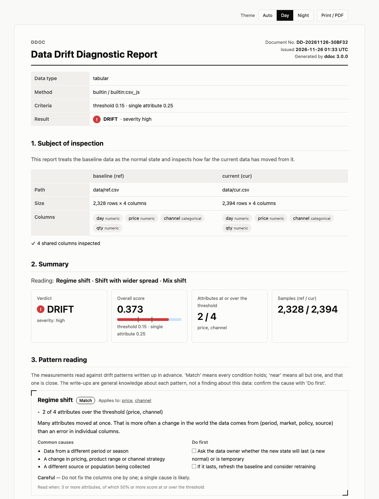
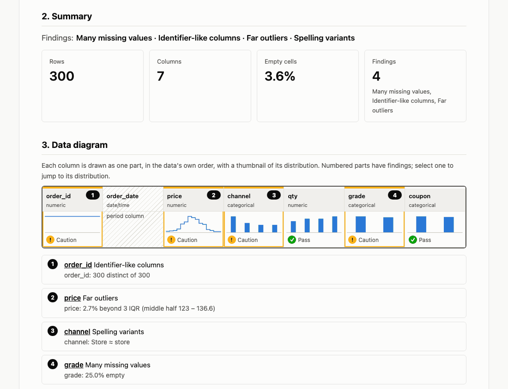
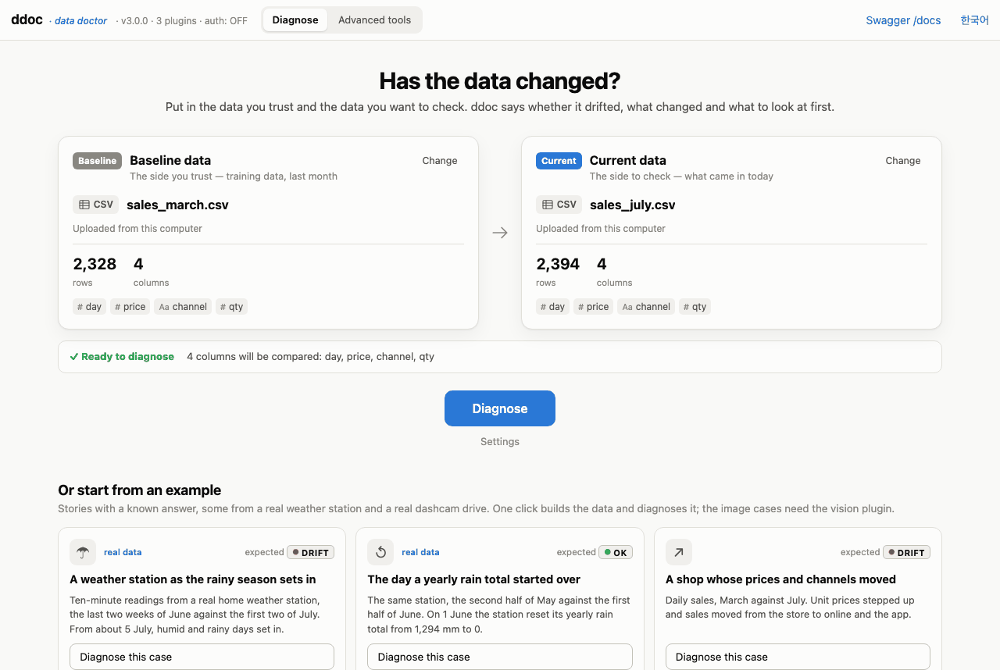
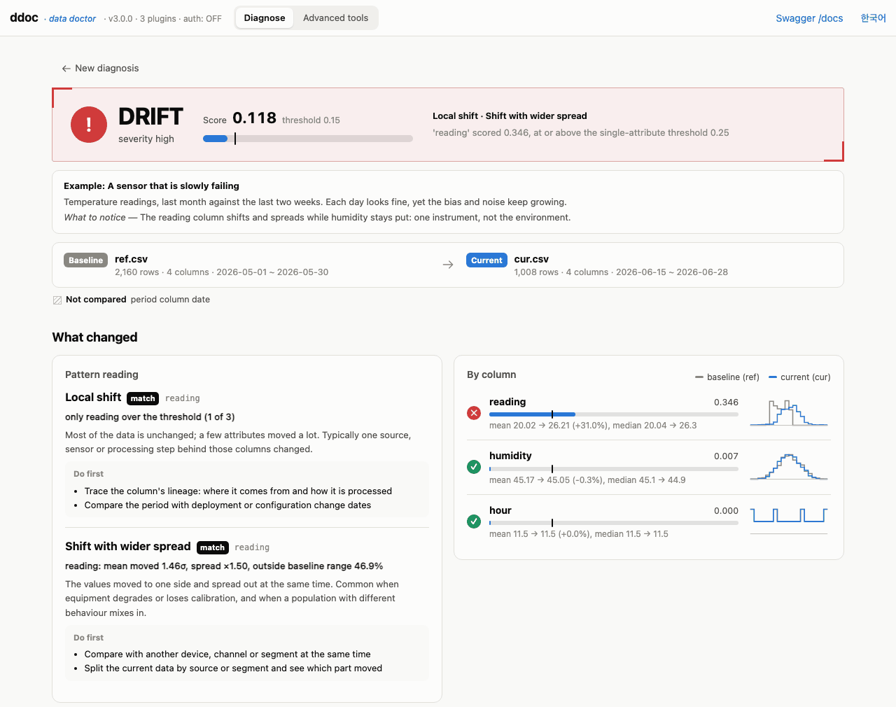

# Usage examples

**English** · [한국어](usage.md)

ddoc **compares a baseline dataset with the current one, answers `OK`, `DRIFT` or `BLIND` (cannot judge),
and leaves a diagnostic report with the evidence**. Below are examples to type as they are, by situation.
The output shown is from real runs.

- [0. Setup](#0-setup)
- [1. Compare two CSV files](#1-compare-two-csv-files)
- [2. Look before you judge](#2-look-before-you-judge)
- [3. Profile a single dataset](#3-profile-a-single-dataset)
- [4. Compare image or text folders](#4-compare-image-or-text-folders)
- [5. Share the result](#5-share-the-result)
- [6. Use it in scripts and CI](#6-use-it-in-scripts-and-ci)
- [7. Browser GUI and REST API](#7-browser-gui-and-rest-api)
- [8. When you forget a command](#8-when-you-forget-a-command)
- [Good to know](#good-to-know)

## 0. Setup

From the repository root:

```bash
./run.sh setup        # create ./.venv, install ddoc + the categorical and tabular plugins ("setup all" for every plugin)
./run.sh doctor       # do the plugins load? are PDF, serve and embeddings available?
./run.sh demo         # a tour on real data: look → profile → judge → report, in outputs/demo/
```

`./run.sh ddoc <command>` runs ddoc from that environment; with the venv activated, plain `ddoc` works
too. Output is in English by default; `--lang ko` or `DDOC_LANG=ko` switches to Korean.

## 1. Compare two CSV files

The most common case. Try it on the "regime shift" case of the [Drift Zoo](../../zoo/) — a story where
the price range and the sales-channel mix changed wholesale.

```bash
cd packages/ddoc/zoo/regime_shift
python make.py                                          # writes data/ref.csv and data/cur.csv (fixed seed)
ddoc diff data/ref.csv data/cur.csv --report note.html
```

```
⚠ DRIFT — severity: high · score 0.3113 (threshold 0.15)
   Most changed attributes: price 1.000 · channel 0.243 · day 0.002
   modality: tabular · engine: builtin · ref: data/ref.csv · cur: data/cur.csv
   ⤷ Diagnostic report: note.html
   ⤷ Reading: Regime shift · Shift with wider spread · Mix shift
   ⤷ The values of 'price' moved. Rule out a unit or scale change, a sensor
     replacement or recalibration before treating it as a real change in the world.
   ⤷ The mix of 'channel' changed (store 75.6% → 19.3%). Confirm whether the
     population really changed (site, channel, time of day) and ...
```

**How to read it**

| Line | Meaning |
|---|---|
| First line | Verdict and severity. The score is the mean distribution difference over the columns |
| Most changed attributes | Score per column (0 = same, 1 = maximum) |
| Reading | The measurements matched against drift patterns written up in advance ([glossary](../glossary.md), Korean) |
| ⤷ hints | What to check first, per pattern |
| Exit code | `0` OK · `1` DRIFT · `2` BLIND — 1 in this example |

The **diagnostic report** (`note.html`) is one file that opens offline, switches between day and night,
and prints to A4. Its sections: subject of inspection → summary → pattern reading → data diagram (one part
per column, numbered where to look) → basis for the verdict with the inspection table → results by attribute
→ findings by attribute → characteristics of the data → items to check → limitations and remarks.



`ref` and `cur` can be folders instead of CSV files; every CSV inside is read.

## 2. Look before you judge

To check the paths, or whether the answer will be BLIND, before judging:

```bash
ddoc probe data/ref.csv data/cur.csv
```

```
  ref: data/ref.csv  → csv  1 file(s)
  cur: data/cur.csv  → csv  1 file(s)
  rows 2,328 / 2,394 · 4 column(s) would be compared
✓ can be judged — a plugin is tried first; if none takes it, the built-in CSV
comparator judges it
```

When the pair cannot be judged it says why and what to do (which plugin to install, for example) and
exits with 2.

## 3. Profile a single dataset

Before comparing, look at one CSV: size, period, per-column distributions and quality findings.

```bash
ddoc analyze eda --data-path data/ref.csv --report profile.html --quiet
```

The quality findings cover missing values, constant columns, identifier-like columns, far outliers,
spelling variants (`Store` ≈ `store`), numbers stored as text and duplicate rows. It also shows which
identifier and date columns are better left out of a drift comparison.



## 4. Compare image or text folders

Needs the vision or text plugin and torch. The plugins are not on PyPI yet, so
`pip install ddoc-plugin-vision` finds nothing; install from the repository's folder (check with `ddoc doctor`).

```bash
./run.sh setup vision                                  # or: pip install -e packages/plugins/ddoc-plugin-vision
ddoc examples generate vision --out /tmp/v --scenario shifted
ddoc diff /tmp/v/ref /tmp/v/cur --with-embeddings --report note.html
```

The report gains an **embedding map**: the items of both sets plotted in two dimensions. When the
**neighbour mixing** is close to 0 the two sets have drifted apart in content. Under the map are file
names to open — the most typical items of each side and the current items least like the baseline.
CLIP ships inside the plugins; only its weights are downloaded, once, on first use.

## 5. Share the result

The extension of `--report` picks the format.

```bash
ddoc diff ref cur --report drift.md                    # Markdown for a PR or issue (items to check as checkboxes)
ddoc diff ref cur --report note.pdf                    # PDF
ddoc diff ref cur --sample-rows 3 --report note.html   # with the first 3 raw rows — mind who receives it
ddoc diff ref cur --issuer "Data team" --report note.html  # the issuer in the report header
```

Keep the result as JSON and render the report again later:

```bash
ddoc diff ref cur --json > result.json
ddoc report render -i result.json -o report.pdf
```

## 6. Use it in scripts and CI

`--json` writes exactly one JSON object to stdout.

```bash
ddoc diff data/ref.csv data/cur.csv --json | jq '.verdict, .overall_score'
# "DRIFT"
# 0.3113
```

The patterns read are under `.diagnosis.archetypes` (`"match"` for a match, `"near"` for near).

**CI data gate** — the exit code is the verdict, so one command is the gate.

```bash
./run.sh gate data/baseline data/incoming note.html     # DRIFT (1) or BLIND (2) stops the pipeline
```

GitHub Actions:

```yaml
- uses: keti-datadrift/datadrift_base_framework@main
  with:
    ref: data/baseline
    cur: data/incoming
    report: drift_note.html
- uses: actions/upload-artifact@v4
  if: failure()
  with: { name: drift-note, path: drift_note.html }
```

For other CI systems see [examples/ci-gate](../../../../examples/ci-gate/).

## 7. Browser GUI and REST API

```bash
ddoc serve            # http://127.0.0.1:8765
```

The front page is the workbench. Drop files or a folder onto the baseline and current sides (or use
"Browse the server" to pick from the server's folders); each side shows what it holds — rows, columns,
period, column names — before anything is judged, and "Diagnose" gives the verdict. The example cases
underneath run a diagnosis without preparing any data.



The result reads top-down: the verdict, the pattern cards with what to do first, each column with its
distributions, then the full report, which can be saved as HTML, PDF or Markdown.



The page opens in English; the "한국어" button in the top bar or `http://127.0.0.1:8765/?lang=ko`
switches it. A link such as `http://127.0.0.1:8765/?case=price-regime` opens straight on an example.
The forms that take the CLI options as they are live under "Advanced tools".

From another service:

```bash
curl -s -X POST http://127.0.0.1:8765/diff -H 'Content-Type: application/json' \
  -d '{"ref": "data/ref.csv", "cur": "data/cur.csv"}'
```

The response is the `ddoc diff --json` payload plus `exit_code` and `report_html` (the whole report).

Started without a key, the server answers only this machine. Set a key before opening it to others:

```bash
DDOC_API_KEY=<long-random-string> ddoc serve --host 0.0.0.0   # every request needs an X-API-Key header
./run.sh docker up                                            # Docker Compose (key required)
```

More in [REST / GUI](../tutorial/serve.md) and [deployment](../tutorial/deploy.md) (Korean).

## 8. When you forget a command

There is a catalog of commands by situation.

```bash
ddoc scenarios                                    # commands by situation
./run.sh menu                                     # pick by number, fill in the values, run
ddoc scenarios run compare --set ref=data/ref.csv --set cur=data/cur.csv -n   # -n: show the commands, do not run
```

The same list is in the GUI under "Advanced tools → Scenarios" and in the [cheat sheet](../cheatsheet.md) (Korean).

## Good to know

- **OK does not guarantee "no change".** With the current thresholds a column whose mean moved by 1σ, or
  a mix that shifted by 30 percentage points, can still be OK. When the verdict is OK but the pattern
  reading lists a **hidden change** or **near** patterns, take a look, and if in doubt lower the bar with
  `--attr-threshold 0.15`.
- **With around 30 rows per side, treat DRIFT as provisional.** Sampling noise alone can produce it; the
  report then also shows "Too few samples". The evidence for both limits and a proposed fix are in
  [verdict sensitivity](../sensitivity.md) (Korean).
- **Date and time columns are not compared**; they only give the period. Formats without a four-digit
  year (`7/1`, ...) are not recognised as dates — check with `ddoc probe`.
- **Running totals are not compared either.** With a time column, a column that only grows over time
  and drops only when it starts over (rain this month, a lifetime count, a sequence number) would
  differ between any two periods; it is named on the console and in the report and set aside. To
  compare the increments, add a differenced column.
- **Large CSVs are compared through a uniform random sample** of 200,000 rows per side; `--max-rows 0`
  reads everything.

More: [command reference](../reference/commands.md) (every option) · [status](../status.md) (what has been
checked) · [glossary](../glossary.md) — all in Korean.
