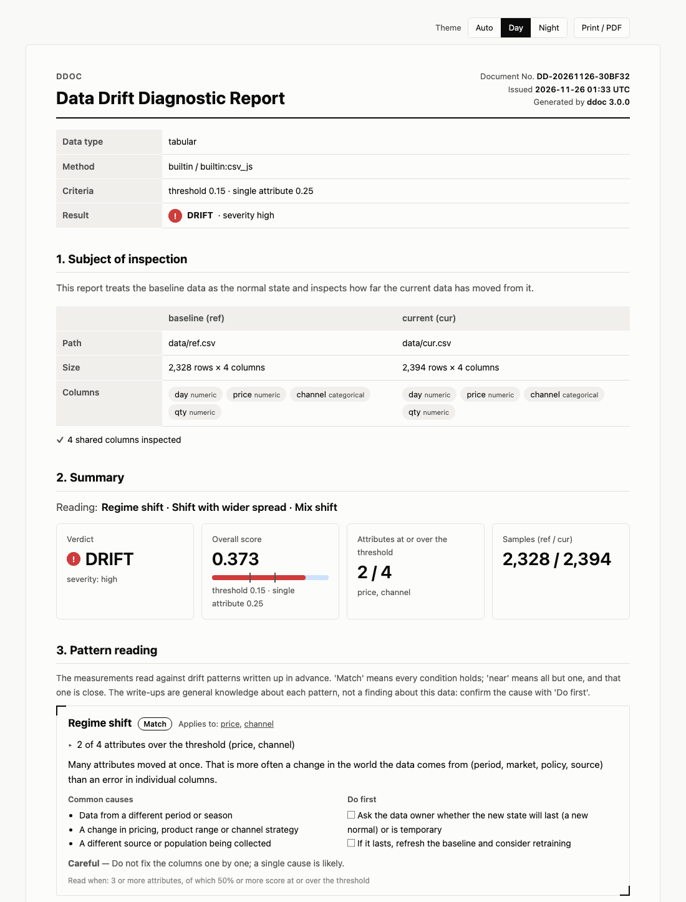
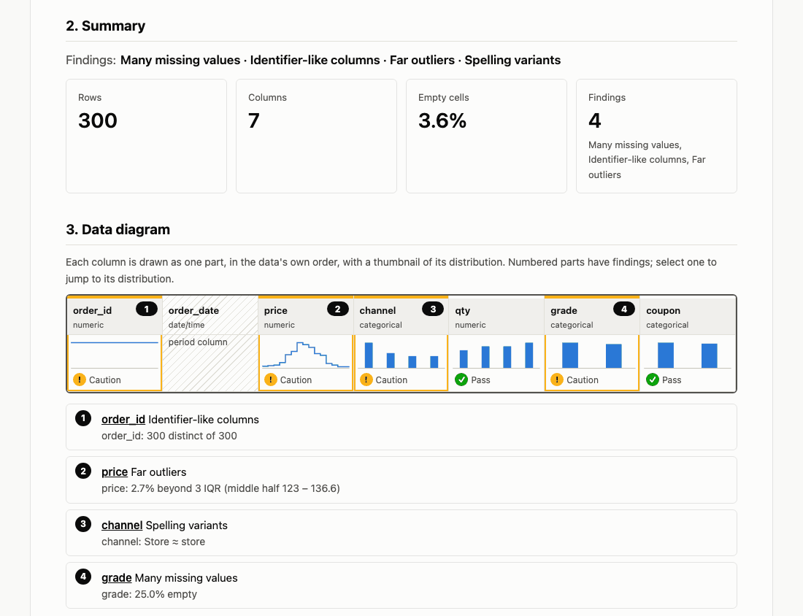
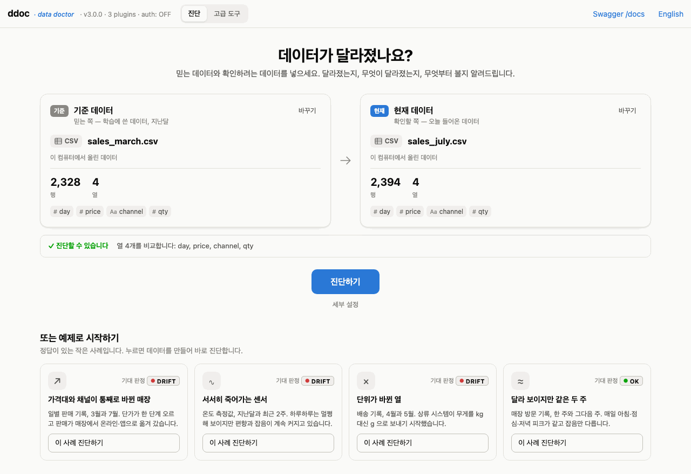
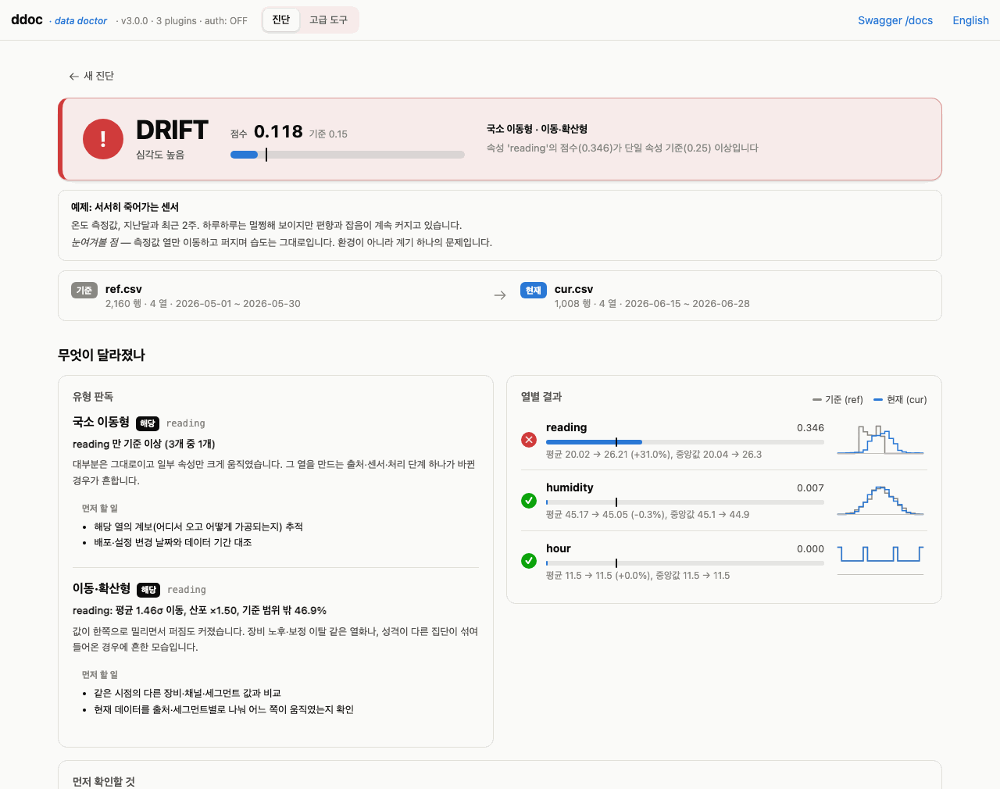

# 사용 예제

[English](usage.en.md) · **한국어**

ddoc 은 **기준 데이터와 현재 데이터를 비교해 `OK` · `DRIFT` · `BLIND`(판정 불가) 중 하나로 판정하고, 그 근거를
진단서로 남기는** 도구입니다. 아래는 상황별로 그대로 따라 칠 수 있는 예제입니다. 출력은 실제 실행 결과입니다.

- [사용 예제](#사용-예제)
  - [0. 준비](#0-준비)
  - [1. 두 CSV 비교하기](#1-두-csv-비교하기)
  - [2. 판정 전에 미리 보기](#2-판정-전에-미리-보기)
  - [3. 데이터 하나 살펴보기](#3-데이터-하나-살펴보기)
  - [4. 이미지·텍스트 폴더 비교](#4-이미지텍스트-폴더-비교)
  - [5. 결과 공유하기](#5-결과-공유하기)
  - [6. 스크립트·CI 에서 쓰기](#6-스크립트ci-에서-쓰기)
  - [7. 브라우저 GUI 와 REST API](#7-브라우저-gui-와-rest-api)
  - [8. 명령이 기억나지 않을 때](#8-명령이-기억나지-않을-때)
  - [알아 둘 점](#알아-둘-점)

## 0. 준비

저장소 루트에서:

```bash
./run.sh setup        # ./.venv 생성, ddoc + categorical·tabular 플러그인 설치 ("setup all" 은 전부)
./run.sh doctor       # 플러그인이 불러지는지, PDF·serve·임베딩을 쓸 수 있는지 점검
./run.sh demo         # 예제 데이터 → 판정 → outputs/demo/ 에 진단서
```

`./run.sh ddoc <명령>` 은 그 환경의 ddoc 을 실행합니다. venv 를 켰다면 `ddoc` 을 바로 써도 됩니다. 한국어 출력은
`--lang ko` 또는 `DDOC_LANG=ko` 입니다(기본은 영어).

## 1. 두 CSV 비교하기

가장 흔한 경우입니다. [Drift Zoo](../../zoo/) 의 "레짐 전환" 케이스 — 가격대와 판매 채널 구성이 통째로 바뀐
이야기 — 로 해 봅니다.

```bash
cd packages/ddoc/zoo/regime_shift
python make.py                                          # data/ref.csv, data/cur.csv 생성 (고정 seed)
ddoc diff data/ref.csv data/cur.csv --lang ko --report note.html
```

```
⚠ DRIFT — 심각도: 높음 · 점수 0.3113 (기준 0.15)
   가장 변한 속성: price 1.000 · channel 0.243 · day 0.002
   모달리티: tabular · 엔진: builtin · 기준: data/ref.csv · 현재: data/cur.csv
   ⤷ 진단서: note.html
   ⤷ 판독: 레짐 전환형 · 이동·확산형 · 구성비 이동형
   ⤷ 'price'의 값이 이동했습니다. 실제 환경 변화로 판단하기 전에 단위·스케일
     변경, 센서 교체·재보정이 아닌지 먼저 확인하세요.
   ⤷ 'channel'의 구성비가 바뀌었습니다 (store 75.6% → 19.3%). 모집단이 실제로
     바뀌었는지(현장, 채널, 시간대) 확인하고 ...
```

**읽는 법**

| 줄 | 뜻 |
|---|---|
| 첫 줄 | 판정과 심각도. 점수는 열별 분포 차이의 평균 |
| 가장 변한 속성 | 열별 점수 (0 = 같음, 1 = 최대) |
| 판독 | 측정값을 미리 정리해 둔 드리프트 유형에 대어 본 결과 ([용어](../glossary.md)) |
| ⤷ 안내 | 유형마다 무엇부터 확인할지 |
| 종료 코드 | `0` OK · `1` DRIFT · `2` BLIND — 이 예제는 1 |

**진단서** (`note.html`) 는 파일 하나로 오프라인에서 열립니다. 주간·야간 화면과 A4 인쇄를 지원하고, 차례는
검사 대상 → 요약 → 유형 판독 → 데이터 도면(열마다 부품 하나, 살펴볼 부품에 번호) → 판정 근거와 계통별 검사표 →
속성별 결과 → 속성별 상세 → 원본 데이터 특징 → 점검 항목 → 한계 및 비고입니다.



`ref`·`cur` 에는 CSV 파일 대신 폴더를 줘도 됩니다. 폴더 안의 CSV 를 모두 읽습니다.

## 2. 판정 전에 미리 보기

경로를 잘못 줬는지, BLIND 가 나올지 먼저 확인할 때:

```bash
ddoc probe data/ref.csv data/cur.csv --lang ko
```

```
  ref: data/ref.csv  → csv  파일 1개
  cur: data/cur.csv  → csv  파일 1개
  행 2,328 / 2,394 · 비교할 열 4개
✓ 판정할 수 있습니다 — 플러그인이 먼저 시도하고, 맡는 플러그인이 없으면 내장 CSV
비교기가 판정
```

판정할 수 없으면 이유와 할 일(어떤 플러그인을 설치할지 등)을 보여주고 종료 코드 2 로 끝납니다.

## 3. 데이터 하나 살펴보기

비교하기 전에 CSV 하나의 규모·기간·열별 분포와 품질 소견을 봅니다.

```bash
ddoc analyze eda --data-path data/ref.csv --report profile.html --quiet
```

품질 소견은 결측, 상수 열, 식별자형 열, 극단값, 표기 변형(`Store` ≈ `store`), 숫자로 된 텍스트, 중복 행입니다.
식별자형 열과 날짜 열은 드리프트 비교에서 빼는 편이 좋다는 것도 여기서 보입니다.



## 4. 이미지·텍스트 폴더 비교

vision 또는 text 플러그인과 torch 가 필요합니다. 플러그인은 아직 PyPI 에 없어 `pip install ddoc-plugin-vision` 처럼
이름으로는 설치되지 않으니, 저장소의 폴더로 설치하세요(`ddoc doctor` 로 확인).

```bash
./run.sh setup vision                                  # 또는: pip install -e packages/plugins/ddoc-plugin-vision
ddoc examples generate vision --out /tmp/v --scenario shifted
ddoc diff /tmp/v/ref /tmp/v/cur --with-embeddings --lang ko --report note.html
```

진단서에 **임베딩 지도**가 들어갑니다. 두 데이터의 항목을 2차원에 찍은 그림으로, **이웃 섞임**이 0 에 가까우면
두 데이터의 내용이 갈라진 것입니다. 지도 아래에 열어 볼 파일 이름(각 쪽의 대표 항목, 기준과 가장 다른 현재
항목)이 나옵니다. CLIP 은 플러그인에 들어 있고, 가중치만 처음 쓸 때 한 번 내려받습니다.

## 5. 결과 공유하기

`--report` 의 확장자가 형식을 정합니다.

```bash
ddoc diff ref cur --report drift.md                    # PR·이슈에 붙일 Markdown (점검 항목이 체크박스로)
ddoc diff ref cur --report note.pdf                    # PDF
ddoc diff ref cur --sample-rows 3 --report note.html   # 원본 앞 3행 포함 — 보낼 대상을 확인하세요
ddoc diff ref cur --issuer "데이터팀" --report note.html  # 진단서 머리글의 발행처
```

결과를 JSON 으로 남겨 두었다가 보고서만 다시 만들 수도 있습니다.

```bash
ddoc diff ref cur --json > result.json
ddoc report render -i result.json -o report.pdf
```

## 6. 스크립트·CI 에서 쓰기

`--json` 은 stdout 에 JSON 객체 하나만 냅니다.

```bash
ddoc diff data/ref.csv data/cur.csv --json | jq '.verdict, .overall_score'
# "DRIFT"
# 0.3113
```

판독된 유형은 `.diagnosis.archetypes` 에 있습니다(`match` 가 `"match"` 인 것이 해당, `"near"` 가 가까움).

**CI 데이터 게이트** — 종료 코드가 판정이라 명령 하나가 게이트입니다.

```bash
./run.sh gate data/baseline data/incoming note.html     # DRIFT(1)·BLIND(2) 면 파이프라인이 멈춤
```

GitHub Actions:

```yaml
- uses: keti-datadrift/datadrift_base_framework@main
  with:
    ref: data/baseline
    cur: data/incoming
    report: drift_note.html
- uses: actions/upload-artifact@v4
  if: failure()
  with: { name: drift-note, path: drift_note.html }
```

다른 CI 는 [examples/ci-gate](../../../../examples/ci-gate/) 를 보세요.

## 7. 브라우저 GUI 와 REST API

```bash
ddoc serve            # http://127.0.0.1:8765
```

첫 화면이 진단 화면입니다. 기준·현재 칸에 파일이나 폴더를 끌어다 놓거나(또는 "서버에서 찾기"로 서버의 폴더를
탐색해) 데이터를 넣으면, 그 데이터가 무엇인지(행·열·기간·열 이름) 먼저 보여주고 "진단하기"로 판정합니다.
아래의 예제 사례를 누르면 데이터 준비 없이 바로 진단해 볼 수 있습니다.



결과는 판정, 유형 판독 카드와 먼저 할 일, 열별 분포 그림, 진단서 전체 순서로 나오고, 진단서는 HTML · PDF ·
Markdown 으로 저장할 수 있습니다.



화면은 영어로 열립니다. 위쪽 막대의 "한국어" 버튼이나 `http://127.0.0.1:8765/?lang=ko` 로 바꿉니다.
`http://127.0.0.1:8765/?case=price-regime` 처럼 예제를 바로 여는 주소도 됩니다. CLI 옵션을 그대로 지정하는 폼은
"고급 도구"에 있습니다.

다른 서비스에서 부를 때:

```bash
curl -s -X POST http://127.0.0.1:8765/diff -H 'Content-Type: application/json' \
  -d '{"ref": "data/ref.csv", "cur": "data/cur.csv", "lang": "ko"}'
```

응답은 `ddoc diff --json` 과 같은 JSON 에 `exit_code` 와 `report_html`(진단서 HTML 전체)이 더해진 것입니다.

키 없이 띄우면 서버는 이 컴퓨터만 상대합니다. 다른 컴퓨터에 열 때는 키를 설정하세요.

```bash
DDOC_API_KEY=<긴-임의-문자열> ddoc serve --host 0.0.0.0     # 요청마다 X-API-Key 헤더 필요
./run.sh docker up                                          # Docker Compose (키 필수)
```

자세한 내용은 [REST / GUI](../tutorial/serve.md) 와 [배포](../tutorial/deploy.md).

## 8. 명령이 기억나지 않을 때

상황별 명령 카탈로그가 있습니다.

```bash
ddoc scenarios                                    # 상황별 명령 목록
./run.sh menu                                     # 번호로 골라 값을 채우고 실행
ddoc scenarios run compare --set ref=data/ref.csv --set cur=data/cur.csv -n   # -n: 실행 없이 명령만
```

같은 목록이 GUI 의 "고급 도구 → 상황별" 탭과 [치트시트](../cheatsheet.md)에 있습니다.

## 알아 둘 점

- **OK 가 "변화 없음"을 보장하지는 않습니다.** 현재 판정 기준에서는 한 열의 평균이 1σ 움직이거나 구성비가
  30%p 바뀌어도 OK 일 수 있습니다. 판정이 OK 여도 유형 판독에 **잠복 변화형**이나 **가까움**이 있으면 살펴보고,
  의심되면 `--attr-threshold 0.15` 로 기준을 낮춰 보세요.
- **쪽마다 30행 안팎이면 DRIFT 를 잠정으로 보세요.** 표본 잡음만으로도 DRIFT 가 납니다. 진단서에 "표본 부족형"이
  함께 나옵니다. 두 한계의 근거와 개선안은 [판정 민감도](../sensitivity.md)에 있습니다.
- **날짜·시간 열은 비교하지 않고 기간 표시에만 씁니다.** 연도 네 자리가 없는 형식(`7/1` 등)은 날짜로 찾지 못하니
  `ddoc probe` 로 확인하세요.
- **큰 CSV 는 쪽마다 20만 행을 균등 무작위로 뽑아 비교합니다.** 모두 비교하려면 `--max-rows 0`.

더 보기: [명령어 레퍼런스](../reference/commands.md) (모든 옵션) · [지금 상태](../status.md) (무엇이 확인됐나) ·
[용어](../glossary.md)
