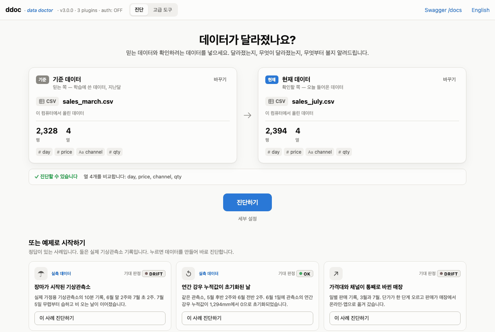
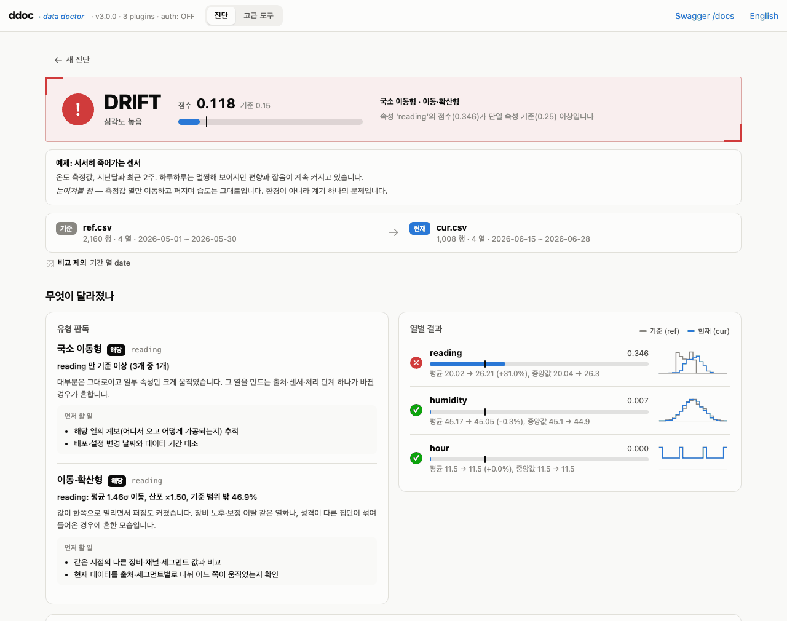

# `ddoc serve` — REST facade in 2 minutes

`ddoc serve` 명령어로 ddoc CLI 의 모든 기능을 HTTP 로
호출할 수 있습니다. curl, scripts, 외부 시스템(형제 앱, 다른
사이트), 또는 browser 의 Swagger UI 에서 즉시 사용 가능.

## 시작

```bash
# 가벼운 실행 (localhost:8765, 인증 disable)
ddoc serve

# 다른 포트 / 외부 노출 (인증 필수)
DDOC_API_KEY=secret ddoc serve --host 0.0.0.0 --port 9000

# 개발 모드 (코드 변경 시 자동 reload)
ddoc serve --reload --log-level debug
```

브라우저로 `http://127.0.0.1:8765/docs` 열면 Swagger UI 에서 모든
엔드포인트를 직접 테스트할 수 있음.

## curl 예제

### Health & metadata

```bash
curl -s http://localhost:8765/healthz | jq
# → {"status":"healthy","ddoc_version":"2.1.0","plugin_count":4,...}

curl -s http://localhost:8765/version | jq
# → {"ddoc":"2.1.0","hookspec":"1.0.0"}
```

### Plugin 목록 + detector 매트릭스

```bash
curl -s http://localhost:8765/plugins | jq '.plugins'
curl -s http://localhost:8765/plugins/detectors | jq '.registry'
```

### CLI 명령어 introspection (GUI auto-populate 용)

```bash
curl -s http://localhost:8765/commands | jq '.tree.subcommands | keys'
# → ["analyze","examples","exp","export","fetch","plugin","report","serve",...]
```

### Toy 데이터 생성 후 drift 분석

```bash
# 1. 합성 데이터 페어 생성
curl -s -X POST http://localhost:8765/examples/generate \
  -H 'Content-Type: application/json' \
  -d '{"modality":"categorical","out":"/tmp/demo","scenario":"shifted"}' | jq

# 2. drift 측정
curl -s -X POST http://localhost:8765/analyze/drift \
  -H 'Content-Type: application/json' \
  -d '{
    "data_path_ref": "/tmp/demo/ref",
    "data_path_cur": "/tmp/demo/cur",
    "quiet": true
  }' | jq
# → {"modality":"categorical","overall_score":0.1111,...}
```

### Streaming 진행 (SSE)

```bash
curl -N -X POST http://localhost:8765/analyze/drift/stream \
  -H 'Content-Type: application/json' \
  -H 'Accept: text/event-stream' \
  -d '{
    "data_path_ref": "/tmp/demo/ref",
    "data_path_cur": "/tmp/demo/cur",
    "quiet": true
  }'
# event: progress
# data: {"progress":0.05,"stage":"start","message":"drift path mode init"}
# event: progress
# data: {"progress":0.2,"stage":"plugin_call",...}
# event: progress
# data: {"progress":0.9,"stage":"merge",...}
# event: progress
# data: {"progress":1.0,"stage":"complete",...}
# event: result
# data: {"modality":"categorical","overall_score":0.1111,...}
```

### 진단 (`ddoc diff`)

판정은 오류가 아니라 답이므로 OK / DRIFT / BLIND 모두 HTTP 200 이고, `exit_code`
(0 / 1 / 2)가 함께 옵니다. `include_report` (기본 true) 이면 진단서 HTML 이
`report_html` 로 함께 와서, 공유 파일시스템 없이 바로 보여줄 수 있습니다.

```bash
curl -s -X POST http://localhost:8765/diff \
  -H 'Content-Type: application/json' \
  -d '{"ref":"/data/jan.csv","cur":"/data/aug.csv","lang":"ko","issuer":"기관명"}' \
  | jq '{verdict, exit_code, hints}'
```

`threshold`, `attr_threshold`, `detector`, `sample_rows`(0–20, 원본 행 미리보기),
`with_embeddings`(이미지·텍스트 임베딩 비교와 임베딩 지도),
`timeout_sec` 도 받습니다.

### Report 렌더 + 외부 export

```bash
# drift envelope 을 파일로 저장한 후
curl -s -X POST http://localhost:8765/analyze/drift \
  -H 'Content-Type: application/json' \
  -d '{"data_path_ref":"/tmp/demo/ref","data_path_cur":"/tmp/demo/cur","quiet":true}' \
  > /tmp/drift.json

# HTML 리포트
curl -s -X POST http://localhost:8765/report/render \
  -H 'Content-Type: application/json' \
  -d '{"input":"/tmp/drift.json","out":"/tmp/r.html","format":"html","title":"My drift report"}' | jq

# 외부 앱으로 발신
curl -s -X POST http://localhost:8765/export/drift-report \
  -H 'Content-Type: application/json' \
  -d '{
    "input": "/tmp/drift.json",
    "target": "http",
    "config": {"base_url": "http://my-app.local:8000", "api_key": "..."}
  }' | jq
```

### 외부 데이터 fetch (file://, s3://, http(s)://, ...)

```bash
# 로컬 디렉터리 복사
curl -s -X POST http://localhost:8765/fetch \
  -H 'Content-Type: application/json' \
  -d '{"source_uri":"file:///mnt/share/audit","dest":"/tmp/audit"}' | jq

# 알려지지 않은 scheme — plugin 없으면 400 + no_adapter_for_scheme
curl -s -X POST http://localhost:8765/fetch \
  -H 'Content-Type: application/json' \
  -d '{"source_uri":"s3://bucket/key","dest":"/tmp/x"}' | jq
```

## 인증

기본은 인증 없음 (localhost-only 가정). 외부 노출 시 반드시
`DDOC_API_KEY` 설정:

```bash
DDOC_API_KEY=mysecret ddoc serve --host 0.0.0.0
```

이후 모든 호출에 `X-API-Key` 헤더 필요:

```bash
curl -H 'X-API-Key: mysecret' http://server.local:8765/plugins
```

`/healthz` 와 `/` 는 auth 우회 (모니터링 용).

키가 없을 때는 서버가 이 컴퓨터만 상대하도록 HTTP 단에서도 막습니다. 브라우저로 아무 웹페이지나 열었을 때
그 페이지가 로컬 서버를 부르는 두 가지 방법을 막기 위해서입니다.

- **DNS rebinding** — `Host` 헤더가 localhost · 127.0.0.1 · ::1 · 바인딩한 주소가 아니면 403
  (`host_not_allowed`). 다른 이름으로 접속해야 하면 `DDOC_ALLOWED_HOSTS=ddoc.lan,box` 처럼 더합니다.
- **다른 사이트에서 보낸 요청** — 무언가를 바꾸는 요청(POST · PUT · DELETE)의 `Origin` 이 서버와 다르면 403
  (`cross_origin_request`). GUI 와 curl·스크립트처럼 `Origin` 을 보내지 않는 클라이언트는 그대로 됩니다.

`--host 0.0.0.0` 에 키 없이 띄우면 다른 컴퓨터에서 IP 로 오는 요청도 첫 번째 규칙에 걸립니다. 다른 컴퓨터를
상대하려면 키를 설정하세요. 키가 있으면 위 두 검사는 꺼지고(다른 사이트는 키를 실어 보낼 수 없으므로) 리버스
프록시가 `Host` 를 바꿔도 그대로 동작합니다.

## Browser GUI

`ddoc serve` 가 띄운 그 서버의 루트(`/`) 에 vanilla HTML/JS GUI 가
같이 service 됩니다. 별도 npm / 빌드 단계 없이 wheel 안에 그대로
embed.

```bash
ddoc serve         # http://127.0.0.1:8765
# 그대로 브라우저로 열기
```

### 진단 화면 (첫 화면)

데이터 두 개를 넣고 진단 결과를 보는 화면입니다. 경로를 외워서 붙여넣을 필요가 없습니다.



**데이터 넣기** — 기준·현재 칸마다 세 가지 방법이 있습니다.

| 방법 | 동작 |
|---|---|
| 끌어다 놓기 · 파일 선택 · 폴더 선택 | 이 컴퓨터의 파일을 서버의 작업 폴더로 올립니다. 폴더는 구조 그대로 올라갑니다 |
| 서버에서 찾기 | 서버의 데이터 폴더를 탐색해 CSV 파일이나 폴더를 고릅니다. 큰 데이터는 올리지 말고 이 방법을 쓰세요 |
| 경로 직접 입력 | 서버의 경로를 알고 있을 때 |

넣는 즉시 그 데이터가 무엇인지 보여줍니다: 종류, 행·열 수, 기간, 열 이름과 형식(이미지 폴더는 미리보기).
두 쪽이 다 차면 판정 전에 미리 확인합니다(`ddoc probe` 와 같음): 비교할 열, 기간 표시에만 쓰는 날짜 열,
한쪽에만 있는 열, 판정할 수 없으면 그 이유.

**예제로 시작하기** — 정답이 있는 사례 네 개가 있습니다(가격대와 채널이 통째로 바뀐 매장, 서서히 죽어가는
센서, 단위가 바뀐 열, 달라 보이지만 같은 두 주). 누르면 데이터를 만들어 바로 진단합니다.

**결과** — 판정(색과 기호, 점수와 기준), 유형 판독 카드(무엇이 왜 그렇게 읽히는지와 먼저 할 일), 열별 결과
(점수 막대와 기준·현재 분포 그림), 먼저 확인할 것, 그리고 진단서 전체가 이어집니다. 진단서는 새 탭으로 열거나
HTML · PDF · Markdown 으로 저장할 수 있고, 같은 일을 하는 CLI 명령을 복사할 수 있습니다.



**주소로 열기** — 진단을 바로 여는 링크를 만들 수 있습니다.

| 주소 | 동작 |
|---|---|
| `/?case=monsoon` | 예제 사례를 바로 진단. 실측 기상 기록 `monsoon`, `yearly-reset` 과 만든 사례 `price-regime`, `sensor-decay`, `unit-change`, `weekday-rhythm` |
| `/?ref=<경로>&cur=<경로>` | 두 칸을 채움. `&run=1` 을 붙이면 바로 진단 |
| `/?lang=ko` | 한국어 화면 (위쪽 막대의 버튼으로도 전환) |
| `/#advanced` | 고급 도구 |

**설정** (환경변수)

| 변수 | 기본값 | 뜻 |
|---|---|---|
| `DDOC_DATA_ROOT` | 서버를 띄운 폴더와 홈 폴더 | "서버에서 찾기"가 보여줄 폴더. 여러 개는 PATH 처럼 `:` 로 구분. 이 밖은 탐색되지 않습니다 |
| `DDOC_WORKSPACE` | 시스템 임시 폴더 아래 `ddoc-workspace` | 올린 파일과 예제 데이터를 두는 곳. 하루 지난 것은 지워집니다 |
| `DDOC_UPLOAD_MAX_MB` | 1024 | 올릴 수 있는 파일 하나의 크기 |

화면이 쓰는 endpoint: `GET /fs/list`, `GET /fs/image`, `POST /workspace/uploads`,
`PUT /workspace/uploads/{id}/{ref|cur}/{이름}`, `GET /cases`, `POST /cases/{id}`, `POST /describe`,
`POST /probe`, 그리고 `POST /diff` (응답의 `view` 가 화면용 요약). 모두 API 키와 로컬 전용 검사를 따릅니다.

### 고급 도구 (CLI 1-to-1)

위쪽 막대의 "고급 도구"에는 CLI 명령마다 폼이 하나씩 있습니다. 입력 칸이 CLI 옵션과 하나씩 대응하고,
오른쪽에 같은 일을 하는 명령이 표시됩니다.

| Tab | 호출 endpoint | 비고 |
|---|---|---|
| 진단 (diff) | `POST /diff` | 판정 카드와 진단서. 옵션을 CLI 그대로 지정할 때 |
| 상황별 | `GET /scenarios` | 상황별 명령 목록(`ddoc scenarios` 와 같은 카탈로그). 명령 복사, `gui` 가 있는 시나리오는 "탭에서 열기"로 해당 탭에 값을 채움. 실행은 각 탭의 Submit 으로만 |
| Analyze drift | `POST /analyze/drift` (또는 `…/stream`) | "Use streaming" 체크 시 SSE 진행 chip |
| Analyze EDA | `POST /analyze/eda` | `data_path` 기반 |
| Examples | `POST /examples/generate` | modality × scenario, 즉시 toy 생성 |
| Report | `POST /report/render` | HTML / PDF / Markdown — drift 입력은 진단서로. `lang`, `issuer` 지정 가능 |
| Export | `POST /export/drift-report` | file / http / 플러그인 |
| Fetch | `POST /fetch` | file:// 기본, plugin scheme 지원 |
| Recipe | `POST /recipe/run` 등 | YAML 레시피 검증·실행·라이브러리 |

- **CLI hint panel** — 폼을 채우는 동안 동등한 `ddoc …` 명령이 표시되고 복사할 수 있습니다.
- **Live validation** — 필수 필드, detector 가 registry 에 있는지, JSON config 가 올바른지 먼저 표시합니다.
- **Drift SSE 스트림** — "Use streaming" 체크 시 진행 상황을 chip 으로 보여줍니다.
- **Auth** — 서버가 `DDOC_API_KEY` 와 함께 시작되면 위쪽 막대에 `X-API-Key` 입력 칸이 나옵니다. 입력값은
  브라우저에 저장되어 새로고침해도 유지되고, 진단 화면도 같은 키를 씁니다.

화면은 OS 의 주간·야간 설정을 따르고, 색과 글꼴은 진단서와 같습니다.

브라우저 우측 위 `Swagger /docs` 링크는 자동 생성된 OpenAPI 문서로
이어집니다 — endpoint signature / Pydantic schema 직접 확인 가능.
