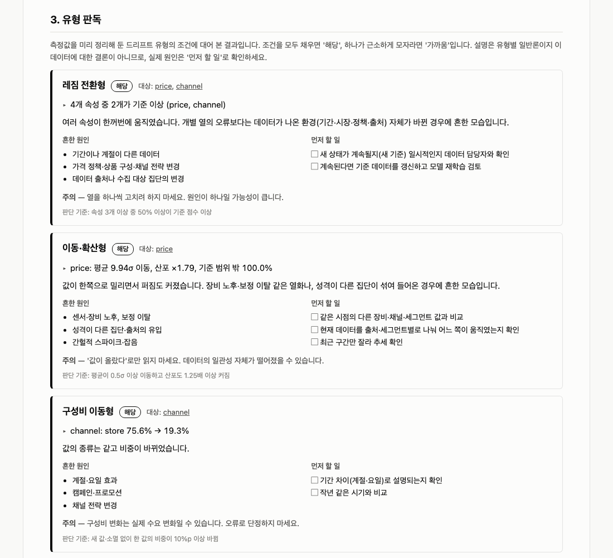

# Drift Zoo 🦓

유명한 드리프트 패턴들을 **한 명령으로 재현**하는 갤러리.
각 케이스는 튜토리얼이자 ddoc의 회귀 테스트입니다(`tests/test_zoo.py`).

```bash
cd zoo/<case>
python make.py            # data/ref.csv, data/cur.csv 생성 (고정 seed)
ddoc diff data/ref.csv data/cur.csv --report note.html
```

| case | 패턴 | 기대 판정 | 이야기 |
|---|---|---|---|
| [`regime_shift/`](regime_shift/) | 영구 레짐 전환 | **DRIFT** (high) | 어느 날부터 세상이 바뀌었고 되돌아오지 않는다 — 가격대·채널 구성이 통째로 이동 |
| [`creeping_degradation/`](creeping_degradation/) | 점진 열화 | **DRIFT** | 하루하루는 멀쩡해 보이는데 한 달 전과 비교하면 센서가 죽어가고 있다 |
| [`rhythm_not_drift/`](rhythm_not_drift/) | 주기 리듬 (함정) | **OK** | 월요일과 화요일은 다르게 *보이지만* 드리프트가 아니다 — 탐지기는 아니라고 말할 줄도 알아야 한다 |
| [`weather_station/`](weather_station/) | **실측 데이터** | **DRIFT** · OK | 가정용 기상관측소의 실제 기록. 장마가 시작되자 이슬점과 습도가 올라섰다(DRIFT). 연간 강우 누적값이 초기화된 날은 누적 열을 빼면 날씨가 그대로다(OK) |
| [`support_tickets/`](support_tickets/) | 텍스트 | **DRIFT** · OK | 앱 업데이트 뒤 로그인·동기화 불만이 몰려오고 글이 길어졌다. 같은 주제를 채팅 창으로 쓰면 말투만으로도 임베딩 지도에서 갈라진다 (text 플러그인 필요) |
| [`machine_sound/`](machine_sound/) | 오디오 | **DRIFT** | 베어링 마모의 충격음이 고주파를 만든다. 마이크만 가까이 옮기면 판독이 단위·스케일 변경형으로 읽는다 (audio 플러그인 필요) |
| [`dashcam/`](dashcam/) | **실측 이미지** | **DRIFT** | 블랙박스 주행의 실제 프레임. 후방 카메라 영상이 들어오면 지도에서 갈라지고, 다음 구간은 풍경 때문에 DRIFT, 실제 프레임에 심은 렌즈 흐림은 잡음 수준보다 훨씬 크다 (vision 플러그인 필요) |

진단서는 측정값을 미리 정리해 둔 드리프트 유형에 대어 보고(유형 판독), 케이스마다
이야기에 맞는 유형이 나오는지도 회귀 테스트로 고정합니다.

| case | 유형 판독 |
|---|---|
| `regime_shift` | 레짐 전환형 · 이동·확산형 · 구성비 이동형 |
| `creeping_degradation` | 이동·확산형 |
| `rhythm_not_drift` | 안정형 |
| `weather_station` (장마) | 이동·수축형 · 수준 이동형 · 이동·확산형 |

`regime_shift` 진단서의 유형 판독 (`ddoc diff data/ref.csv data/cur.csv --lang ko --report note.html`):



## 판독 드릴

이야기 케이스 말고도, 유형마다 변화 하나만 심은 작은 **드릴**([`drills.py`](drills.py))이 있습니다.
각 드릴은 "이 데이터는 이 유형으로, 이 열에서 읽혀야 한다"는 정답을 갖고, [`eval.py`](eval.py) 가
실제 `ddoc diff` 로 돌려 맞춰 봅니다(`./run.sh zoo`). 아래 표는 그 결과로 만들어지며
(`./run.sh docs build`), 테스트가 전부 맞는지 확인합니다. 판정 규칙의 후보를 드릴과 무변화 데이터로
비교하는 [`sensitivity.py`](sensitivity.py) 의 결과는 [판정 민감도](../docs/sensitivity.md)에 있습니다.

<!-- generated:zoo-eval — scripts/docs.py build -->
케이스 21개 중 21개가 기대한 판독과 정확히 일치합니다 (빠진 유형도, 더 나온 유형도 없음). 유형 18가지 중 17가지를 드릴로 확인하며, 임베딩 분리형은 이미지·텍스트 플러그인이 필요해 드릴에서 뺐습니다.

| 케이스 | 심은 변화 | 판정 (최대 속성 점수) | 판독 | 결과 |
|---|---|---|---|---|
| `stable` | 같은 분포의 다른 표본 | OK (0.000) | 안정형 | ✓ |
| `small-sample` | 같은 분포, 쪽마다 20행 | OK (0.000) | 표본 부족형 | ✓ |
| `schema-change` | 같은 분포 + 현재에만 있는 열 | OK (0.000) | 구성 변경형 | ✓ |
| `regime-shift` | 4개 열 중 3개가 함께 이동 (가격대·수량·채널 구성) | DRIFT (0.911) | 레짐 전환형 · 수준 이동형 (price, qty) · 구성비 이동형 (channel) | ✓ |
| `local-shift` | 6개 열 중 1개만 2σ 이동 | DRIFT (0.508) | 국소 이동형 · 수준 이동형 (m6) | ✓ |
| `hidden-change` | 1–5 점수의 평균이 크게 내려갔지만 분포 점수는 기준 아래 | OK (0.135) | 잠복 변화형 · 이동·확산형 (rating) | ✓ |
| `unit-change` | 값 ×1000 (단위 변경) | DRIFT (1.000) | 국소 이동형 · 단위·스케일 변경형 (x) | ✓ |
| `stuck-values` | 값이 7.0 하나로 고정 | DRIFT (1.000) | 국소 이동형 · 고착형 (x) | ✓ |
| `shift-and-spread` | 평균 +1σ, 산포 ×1.8 | OK (0.161) | 국소 이동형 · 잠복 변화형 · 이동·확산형 (x) | ✓ |
| `level-shift` | 평균 +1σ, 산포 그대로 | OK (0.192) | 국소 이동형 · 잠복 변화형 · 수준 이동형 (x) | ✓ |
| `spread-change` | 평균 그대로, 산포 ×2 | OK (0.139) | 잠복 변화형 · 산포 변화형 (x) | ✓ |
| `tail-outliers` | 몸통은 그대로, 약 8%가 기준 범위 훨씬 밖 | OK (0.043) | 잠복 변화형 · 극단값 출현형 (x) | ✓ |
| `missing-surge` | 값 분포는 그대로, 결측 25% | OK (0.002) | 잠복 변화형 · 결측 증가형 (x) | ✓ |
| `new-category` | 새 값 app 이 20% 로 등장 | OK (0.106) | 잠복 변화형 · 새 범주 유입형 (kind) | ✓ |
| `vanished-category` | 값 app (20%) 이 사라짐 | OK (0.108) | 잠복 변화형 · 범주 소멸형 (kind) | ✓ |
| `mix-shift` | 같은 값들의 비중이 70/30 → 40/60 | OK (0.055) | 잠복 변화형 · 구성비 이동형 (kind) | ✓ |
| `shift-and-narrow` | 평균 +1σ, 산포 ×0.5 | DRIFT (0.310) | 국소 이동형 · 이동·수축형 (x) | ✓ |
| [regime_shift](regime_shift/) | 이야기 케이스 | DRIFT (1.000) | 레짐 전환형 · 이동·확산형 (price) · 구성비 이동형 (channel) | ✓ |
| [creeping_degradation](creeping_degradation/) | 이야기 케이스 | DRIFT (0.336) | 이동·확산형 (reading) | ✓ |
| [rhythm_not_drift](rhythm_not_drift/) | 이야기 케이스 | OK (0.010) | 안정형 | ✓ |
| [weather_station](weather_station/) | 이야기 케이스 | DRIFT (0.909) | 이동·수축형 (dew_point_c) · 수준 이동형 (humidity, rain_hourly_mm, temp_c) · 이동·확산형 (feels_like_c, pressure_inhg) | ✓ |

**판정 민감도.** 변화를 심은 속성 드릴 8개(`shift-and-spread`, `level-shift`, `spread-change`, `tail-outliers`, `missing-surge`, `new-category`, `vanished-category`, `mix-shift`)가 판정은 OK 입니다. 판독은 변화를 정확히 짚고(잠복 변화형으로도 표시) 있지만, 분포 점수(Jensen–Shannon 발산)가 단일 속성 기준 0.25 에 닿지 않습니다. 판정 기준과 점수 방식은 따로 정할 문제라 드릴은 판정을 확인하지 않고 그대로 보여줍니다. 후보 방식의 비교는 [판정 민감도](../docs/sensitivity.md)에 있습니다.
<!-- /generated:zoo-eval -->

세 번째 케이스가 핵심입니다: 모든 것을 DRIFT라 우기는 탐지기는 알람 피로만
만듭니다. ddoc의 판정은 3값(OK / DRIFT / BLIND)이고, Zoo는 세 답이 모두
나오는 것까지 검증합니다.
